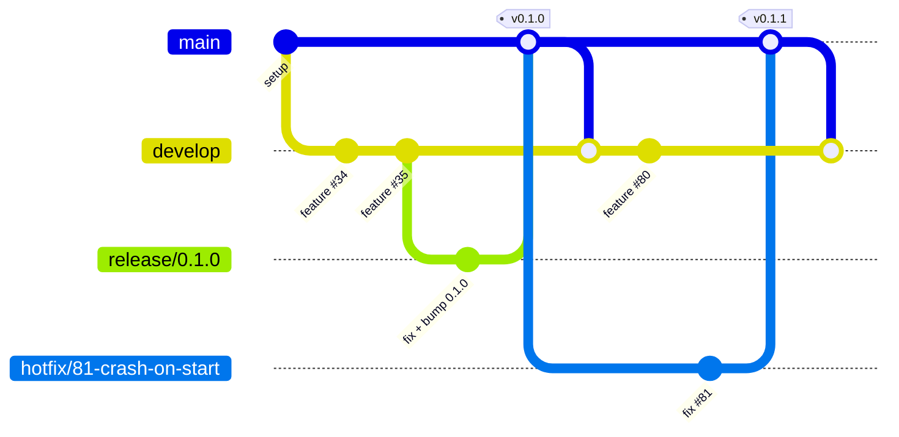

# Development workflow

> How work moves from a ticket to a release in this project. Claude sessions (`implement-ticket`, `coordinator`) and people follow this file; keep it current.

## 1. Requirements

Windows 10/11 x64 only (macOS/Linux builds are out of scope for v1).

| Tool | Version | Check |
|---|---|---|
| Node.js | current LTS (24.x; set up with 24.20.0) | `node --version` |
| npm | comes with Node.js (11.x; set up with 11.19.0) | `npm --version` |
| Rust (rustup) | stable, `x86_64-pc-windows-msvc` (set up with 1.99.1) | `rustc -V`, `cargo -V` |
| Visual Studio 2022 Build Tools | "Desktop development with C++" workload | `cargo build` links without errors |
| WebView2 Runtime | ships with Windows 11 | present in "Apps" |
| Git | any recent | `git --version` |
| GitHub CLI | any recent | `gh auth status` |
| Ollama (optional, for the local provider and `eval`) | latest | `ollama --version` |
| Claude Code (optional, for the Claude provider) | latest | `claude --version` |

Step-by-step install and troubleshooting: [`docs/dev-setup.md`](dev-setup.md).

## 2. Commands

Run from the repo root unless the row says `src-tauri`. The `src-tauri` commands also work from the root with `--manifest-path src-tauri/Cargo.toml`. `cargo clippy --locked` needs `src-tauri/Cargo.lock` to be committed and up to date.

| Task | Command |
|---|---|
| Install dependencies | `npm ci` |
| Run locally (dev) | `npm run tauri dev` |
| Lint (frontend) | `npm run lint` (ESLint: typescript-eslint, react-hooks) |
| Typecheck (frontend) | `npm run typecheck` (`tsc --noEmit` for `src/` and for the Vite/ESLint configs) |
| Format (frontend, writes files) | `npm run format` (Prettier; skips `docs/`, `*.md`, `src-tauri/`, `src/bindings/`) |
| Frontend build (needed before any cargo step) | `npm run build` |
| Rust format check (`src-tauri`) | `cargo fmt --check` |
| Rust lint (`src-tauri`) | `cargo clippy --all-targets --locked -- -D warnings` |
| Regenerate TS bindings (commit the result) | `npm run bindings` (runs ts-rs's generated `export_bindings` exports through `cargo test`; there are no hand-written tests) |
| **Full check** (build and lint, what CI runs) | all of the above in this order: `npm ci`, lint, typecheck, `npm run build`, then in `src-tauri` fmt, clippy, then `npm run bindings` and `git diff --exit-code src/bindings` |
| Build the installer | `npm run tauri build` (output in `src-tauri/target/release/bundle/nsis/`) |
| Translation quality report (manual, needs a provider) | `cargo run --bin eval` (in `src-tauri`) |

The frontend commands (`npm ci`, `lint`, `typecheck`, `format`, `build`, `tauri dev`) and the `src-tauri` fmt/clippy commands are real since T2 (#34). `npm run bindings`, `cargo run --bin eval` and `tauri build` are still **planned** (T3 #35, T4 #36 and later tasks make them real and update this table and `CLAUDE.md` if anything differs).

## 3. Branches

Git Flow, adapted for a project worked on by Claude sessions.

| Branch | Purpose | Created from | Merges into | Lives |
|---|---|---|---|---|
| `main` | **Released code only.** Starts at the project setup commits and changes only when a release or hotfix merges in. Every such merge is tagged `vX.Y.Z`. | — | — | permanently |
| `develop` | **Integration branch** and the repo's GitHub default branch. Every ticket PR targets it and is checked before merging; it must always build and pass lint (the full check). | `main` (setup commits) | `release/*` (by branching off) | permanently |
| `feature/<n>-<slug>`, `fix/…`, `refactor/…`, `docs/…`, `chore/…` | One ticket each | latest `origin/develop` | `develop` (squash) | until merged |
| `release/<X.Y.Z>` | **Stabilizes one milestone:** bug fixes, version bump and changelog only; no new features | `develop`, once the milestone's tickets are merged | `main` (merge commit + tag), then back into `develop` | until released |
| `hotfix/<n>-<slug>` | **Urgent fix to the released version** | latest `origin/main` | `main` (merge commit + tag), then `develop` and any open `release/*` | until released |

Rules:
- Nobody commits directly to `main` or `develop`; everything goes through a PR.
- Every new branch starts from the **latest remote version** of its base: `git fetch origin <base>`, then `git switch -c <branch> origin/<base>`.
- Ticket PRs **squash-merge** into `develop`. Release and hotfix PRs merge into `main` with a **merge commit** (no squash), so each release is one visible merge and `main` merges back into `develop` cleanly.
- After every merge into `main`, merge `main` back into `develop` (a PR) right away.

## 4. Versions and milestones

[Semantic Versioning](https://semver.org): `MAJOR.MINOR.PATCH`. `0.x` until the first stable release; MINOR for a milestone with new features; PATCH for hotfixes (e.g. `0.1.0` → `0.1.1`).

The version has one source of truth, `package.json`; `scripts/bump-version.mjs` (T31, #66) syncs it to `src-tauri/tauri.conf.json` and `src-tauri/Cargo.toml`.

Each GitHub milestone is one release:

| Milestone | Version | Goal | Status |
|---|---|---|---|
| v0.1.0 | 0.1.0 | The whole v1 plan: a daily-usable tray app anyone can install (both providers, main window, popup, history, setup wizard, installer, updater, layout fix, and session send if spike T37 is GO) | planned |

If spike T37 (#72) is NO-GO, story S9.2 (#31, #73–#75) is labelled `status:on-hold` and removed from the milestone; v0.1.0 ships without it.

## 5. Release process

1. Every ticket in the milestone is closed (or on hold and removed from it) and `develop` is green.
2. Cut the release branch: `git fetch origin develop`, `git switch -c release/X.Y.Z origin/develop`. Bump the version (`node scripts/bump-version.mjs X.Y.Z`), update `CHANGELOG.md`, push, and open a PR into `main`.
3. Only fixes go into the release branch (PRs into `release/X.Y.Z`), each also needed on `develop` (it comes back with step 6).
4. Run the smoke test (`docs/smoke-test.md`, T7) on an installer built from the release branch, including the Windows Sandbox section.
5. When it passes: merge the PR into `main` (merge commit) and push the tag `vX.Y.Z` on that merge commit. The tag triggers `.github/workflows/release.yml`, which builds the signed installer and creates a **draft** GitHub release with `latest.json`. Check the draft and publish it; publishing is what makes the in-app updater see it.
6. Merge `main` back into `develop`, delete the release branch, and close the milestone.

Updater signing keys, repo secrets and what to do if a release build fails: `docs/release.md` (T31, #66).

## 6. Hotfix process

1. A ticket labelled `hotfix` describes the bug in the released version.
2. Branch `hotfix/<n>-<slug>` from the latest `origin/main`. Fix the bug, bump PATCH, and update `CHANGELOG.md`.
3. PR into `main`; merge (merge commit), tag, publish the release as in §5 step 5.
4. Merge `main` back into `develop`, and into the open `release/*` branch if there is one.

## 7. Approvals

The owner explicitly approves every step that merges into `main` or a `release/*` branch, pushes a tag, publishes a GitHub release, adds repo secrets or changes repo settings. The coordinator only merges ticket PRs into `develop`.

## 8. Tickets and PRs

- One ticket = one branch = one PR into `develop`, with `Closes #<n>` in the body.
- No automated tests: a ticket's PR merges when build and lint pass, git is clean, its acceptance criteria are met and it has no conflicts. Behaviour criteria with example inputs and outputs are checked by hand (e.g. in dev mode or with a scratch `main`), not with test code.
- Branch, commit and PR naming follow the owner's conventions (Conventional Commits, `#<n>` in commit scopes and PR titles).
- **Spikes** (T13 #45, T16 #48, T37 #72) and tasks that need the owner's hands (T1 #33 installs, T31 #66 signing keys and secrets) stop for the owner; they are never completed unattended.
- A PR that changes Rust types exported to TS includes the regenerated `src/bindings/`.

## 9. CI

`.github/workflows/ci.yml` (T4, #36) runs the full check (§2: build, lint and the bindings diff) on `windows-latest` for pull requests into `develop`, `release/*` and `main`, and for pushes to those branches. No automated tests, and no network or LLM calls in CI. `.github/workflows/release.yml` (T31, #66) runs on `v*` tags.

Until CI exists, run the full check locally before every merge.
